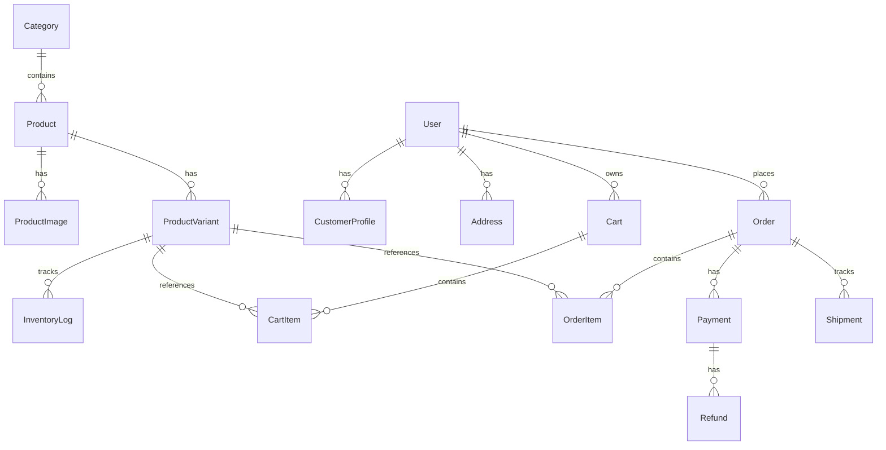

# DATABASE DESIGN SPECIFICATION: MorningVeg Apparel E-Commerce

**Engine:** PostgreSQL 18.6 (Neon Serverless Lakebase)  
**ORM:** Prisma 7.10 + `@prisma/adapter-neon`  
**Current State:** Initial foundational schema created and synced. Full M2 design pending milestone entry.

---

## 1. Entity-Relationship Overview

---

## 2. Core Entity Definitions

### A. Catalog & Apparel Variants
1. **Category (`categories`):**
   - High-level taxonomy (e.g., T-Shirts, Shirts, Trousers, Knitwear, Accessories).
   - Fields: `id`, `name`, `slug`, `description`, `createdAt`, `updatedAt`.
2. **Product (`products`):**
   - Base apparel item information.
   - Fields: `id`, `name`, `slug`, `description`, `basePrice`, `categoryId`, `createdAt`, `updatedAt`.
3. **ProductImage (`product_images`):**
   - Gallery images with display order and primary thumbnail flag.
   - Fields: `id`, `productId`, `url`, `altText`, `sortOrder`, `isPrimary`.
4. **ProductVariant (`product_variants`):**
   - Concrete SKU representing specific size and color combinations.
   - Fields: `id`, `productId`, `sku` (unique), `size` (e.g. S, M, L, XL, 32, 34), `color` (e.g. Olive, Navy, Charcoal), `price`, `stock`, `createdAt`, `updatedAt`.
5. **InventoryLog (`inventory_logs`):**
   - Immutable audit trail tracking stock movements (restock, purchase reservation, return, manual adjustment).

### B. Customer Accounts & Identity
1. **User (`users`):**
   - Core authentication entity.
   - Fields: `id`, `email` (unique), `passwordHash`, `role` (`CUSTOMER` | `ADMIN`), `createdAt`, `updatedAt`.
2. **CustomerProfile (`customer_profiles`):**
   - Personal details.
   - Fields: `id`, `userId`, `firstName`, `lastName`, `phone`.
3. **Address (`addresses`):**
   - Customer shipping and billing addresses.
   - Fields: `id`, `userId`, `street`, `city`, `state`, `postalCode`, `country`, `isDefaultShipping`, `isDefaultBilling`.

### C. Cart, Checkout & Orders
1. **Cart & CartItem (`carts`, `cart_items`):**
   - Persistent shopping cart for authenticated users; guest cart session tokens.
2. **Order (`orders`):**
   - Immutable historical transaction record.
   - Fields: `id`, `orderNumber` (unique human-readable), `userId`, `status` (`PENDING`, `PAID`, `PROCESSING`, `SHIPPED`, `DELIVERED`, `CANCELLED`), `subtotal`, `discountTotal`, `shippingFee`, `grandTotal`, `shippingAddressSnapshot`, `createdAt`, `updatedAt`.
3. **OrderItem (`order_items`):**
   - Line items with **frozen price snapshot** at time of purchase.
   - Fields: `id`, `orderId`, `productVariantId`, `productName`, `sku`, `size`, `color`, `unitPrice`, `quantity`, `subtotal`.

### D. Payments & Auditing
1. **Payment (`payments`):**
   - Records Razorpay order ID, payment ID, signature, payment method (`UPI_INTENT`, `UPI_QR`, `CARD`, `NETBANKING`), and status (`CAPTURED`, `FAILED`).
2. **Refund (`refunds`):**
   - Tracks refund attempts, amounts, and Razorpay refund IDs.
3. **SystemStatus (`system_status`):**
   - Internal diagnostic heartbeat table (active in M1).

---

## 3. Database Principles & Guardrails
- **Historical Price Protection:** Order items must snapshot product variant attributes and price at the exact moment of order placement. Future catalog price updates must never mutate historical orders.
- **Stock Integrity:** Inventory decrements must occur within atomic database transactions with concurrency locks to prevent overselling.
- **Foreign Keys & Cascades:** Cascading deletes only on transient data; strict `Restrict` or `NoAction` on historical orders, payments, and invoices.
